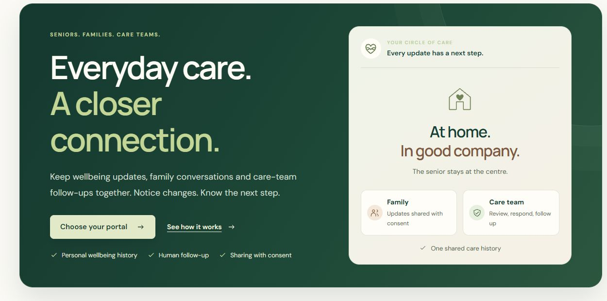
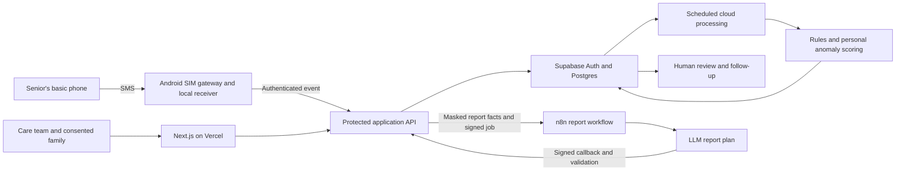

# SwasthSync

**Explained daily care priorities and an SMS help route for seniors living at home.**

[](https://github.com/mayank7720/Deviathon-2.O-Samarth-Care-/actions/workflows/verify.yml)

[Live website](https://swasthsync.vercel.app/) · [Run locally](docs/QUICKSTART.md) · [Demo walkthrough](docs/DEMO_SCRIPT.md) · [Architecture](docs/ARCHITECTURE.md) · [Feature status](docs/PROJECT_STATUS.md)

**Deviathon 2.0 | CodeBurner | DEVS09 | DEV_104**

This is the consolidated hackathon showcase repository. Ongoing development lives in [RageRizzzler/Samarth-Care](https://github.com/RageRizzzler/Samarth-Care). The project responds to Samarth Life Management's *Early Warning for Seniors Living at Home* problem statement. It is an independent student prototype with synthetic records, not Samarth's production care system.



## The care journey

A care coordinator needs to decide who needs attention today, understand the evidence and record what happens next. Seniors need an accessible route into that workflow.

1. A senior sends **HELP** from their registered phone to the configured project helpline. They do not need to open the website.
2. The SMS receiver authenticates the gateway event, matches the account and saves a support request in the cloud.
3. The assigned coordinator receives a notice identifying the senior and supported reported issue. Family notices require current sharing and channel consent. Plain HELP retains an unconfirmed reason.
4. Staff review the request alongside vitals, medicine logs, bilingual notes and personal changes, then record a follow-up and its outcome.
5. Staff can prepare an evidence-backed weekly AI draft, review it and share the reviewed version with selected linked family accounts.

**SMS delivery is not proof of human response.** This prototype does not diagnose conditions, prescribe treatment, dispatch emergency services or guarantee a response time. Voice-only accessibility remains unfinished.

## What works, and what remains unfinished

| Area | Showcase status |
|---|---|
| Four portals | Operations administration, scoped coordinators, linked family members and seniors; server-side role checks |
| Daily priority | Rules, measured personal references, calibrated Isolation Forest and sustained-change evidence, with reasons and a suggested human action |
| Records and monitoring | Dated vitals, medication logs and Hindi/English/Hinglish notes; day/week/month charts and explicit missing data |
| HELP SMS | Physical inbound HELP, saved cloud request and coordinator/family delivery receipts have been verified. Live operation needs the Android phone, SIM, laptop and receiver online. |
| Weekly AI summaries | Published n8n workflow has generated a genuine model draft. Evidence preview, review, recipient selection and publication history are cloud-backed. Inference is explicitly requested. |
| Medication patterns | Logged missed-dose and scheduled-time patterns; missing/pending/conflicting entries remain unknown. No drug-interaction checker. |
| SMS intent ML | Authored synthetic classifier evaluated in **shadow mode**. It failed release gates; automatic model-only routing is disabled. Explicit command and supported cue rules remain separate. |
| Two-way SMS check-ins | Implemented and tested in code; full physical question-and-reply acceptance remains pending. |
| AI Call Bot | **Under development; excluded from the live showcase.** Prepared code and controls do not establish a completed application bot call. |
| Sensors and feedback | Experimental unconfirmed motion candidates and feedback collection. Continuous wearable validation and demonstrated feedback-driven improvement remain outstanding. |

See [current status and limits](docs/PROJECT_STATUS.md) and [PS coverage](docs/REQUIREMENTS.md). Older dated release notes are historical checkpoints.

## Quick start: isolated local demo

Requires **Node.js 22.13+**, npm and Git. No cloud credentials, model subscription or telephone provider is required for the local synthetic fixture.

```bash
git clone https://github.com/mayank7720/Deviathon-2.O-Samarth-Care-.git
cd Deviathon-2.O-Samarth-Care-
npm ci
npm run db:init
npm run dev
```

Open **http://127.0.0.1:5173/** and use the local role options on the sign-in page. They exist only in explicit loopback fixture mode and are not public website credentials. The local SQLite/D1 fixture does not reproduce every cloud-only account, report-management or integration operation.

For hosted authentication, your own Supabase setup, environment templates and troubleshooting, follow [QUICKSTART](docs/QUICKSTART.md). Hosted access requires an assigned account; private demo logins are supplied separately to evaluators.

## Architecture



User traffic uses the signed-in identity and scoped database policies. Background workers have separate protected capabilities. n8n orchestrates reports; it does not supply telephone service. [Architecture and privacy boundaries](docs/ARCHITECTURE.md)

## AI, data and evaluation

- **200 fictional seniors over 90 calendar days**, with 17,226 observed entries in the default reference-informed cohort. Gaps and modality-specific missingness are intentional.
- Starting distributions use documented **MITRE Synthea aggregate references**. Synthea and our generated records are synthetic; this is not an Indian patient cohort.
- **Personal risk v3:** robust median/MAD references, explicit rules, a 48-tree Isolation Forest with nine features, separate calibration and sustained-change checks.
- **Identity split:** 120 fitting, 30 calibration and 50 evaluation seniors. Later observations do not enter an earlier score.
- **Representative synthetic result:** review priority on 28/40 authored case-days (70%); high priority on 17/40 (42.5%). Only two authored cases are represented. Mean first review is **four days after onset**. These results do not establish clinical precision, recall or useful early-warning lead time.
- **Weekly LLM:** selects and orders allowed computed facts; the server validates and renders the result. It does not determine a diagnosis or daily risk score. Computed reports are labelled when no LLM is used.

[Data provenance](docs/DATA_REALISM.md) · [Risk evaluation](docs/ALGORITHM_V3_2026_10_30.md) · [Frozen results](docs/evaluation/personal-risk-v3.json) · [SMS classifier evaluation](docs/SMS_MODEL_EVALUATION.md) · [n8n report contract](docs/N8N.md)

## Verification

```bash
npm run check:repo
npm test
npm run typecheck
npm run build:vercel
npm run evaluate:representative
```

Evaluation output goes into ignored `outputs/`. The latest consolidated source passed **516 automated behaviour checks**, TypeScript and a production build. Engineering tests, synthetic model metrics and physical carrier acceptance are separate forms of evidence. Hosted SQL fixtures need a separate test project and are not run by `npm test`.

CI validates repository hygiene, behaviour, types and both supported build paths without production credentials. See [CONTRIBUTING](CONTRIBUTING.md).

## Project layout

| Path | Purpose |
|---|---|
| `app/` | Public pages, protected workspace, role-specific components and API entry point |
| `lib/` | Scoring, access checks, reports, SMS understanding, workflow and storage adapters |
| `supabase/` | Ordered migrations and protected background functions |
| `data/`, `public/showcase-data.json` | Synthetic/reference assets and authored language examples |
| `n8n/` | Workflow builders and importable report templates |
| `scripts/`, `bridge/` | Local setup, evaluation, SMS relay, speech and experimental calling infrastructure |
| `tests/` | Behaviour regressions and separately invoked database fixtures |
| `docs/` | Setup, demo, architecture, evidence and dated release history |

## Team and disclosures

**CodeBurner, DEVS09:** Mayank Raj, Raghav Agarwal, Aditya Sharma and Dev Thakur.

The implementation uses open-source frameworks, cited methods and AI coding assistance from Codex/ChatGPT and Claude. Team members remain responsible for reviewing and explaining the code. See [third-party acknowledgements](THIRD_PARTY_NOTICES.md), [security guidance](SECURITY.md) and the [documentation index](docs/README.md).

Showcase operation uses existing free tiers, hackathon n8n/model credits and an included-SMS SIM plan. These allocations do not establish zero-cost production operation or proven capacity for 10,000 seniors. No licence for original project code is granted by this README; third-party components retain their respective licences.
