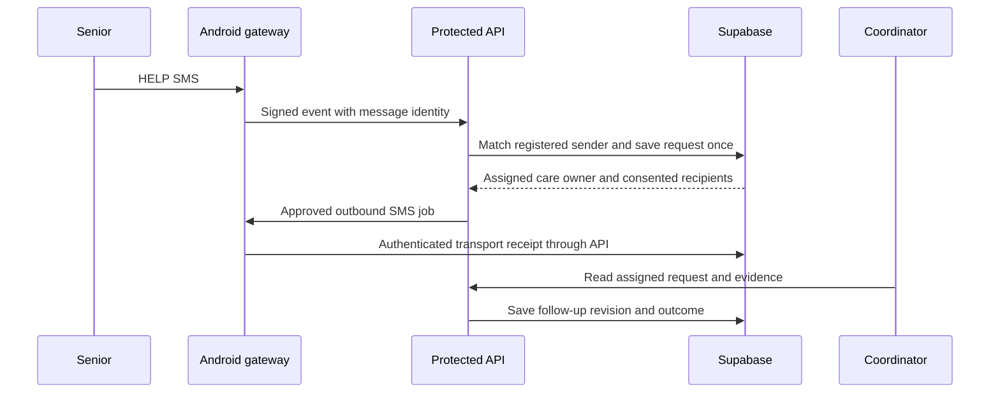
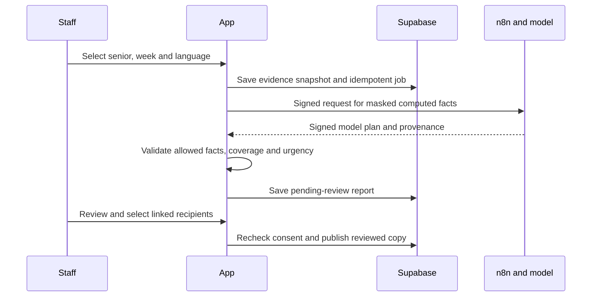

# Architecture

## Components

| Component | Responsibility | Boundary |
|---|---|---|
| Next.js/React on Vercel | Public pages, authenticated workspace and protected API | Public pages do not grant care access |
| Supabase Auth/Postgres | Identity, memberships, household consent, dated evidence, cases, jobs and review history | User operations use their access token and scoped policies |
| Shared JavaScript engine | Personal references, rules, Isolation Forest, sustained change and explanations | Anomaly and priority scores are not illness probabilities |
| Protected Edge workers | Scheduled processing and narrow signed integration callbacks | Background service capabilities are not browser credentials |
| n8n report workflow | Orchestrate a requested model report plan and signed completion | No direct patient contact; no provider authority over care access |
| Android SMS relay | Receive helpline SMS and deliver approved account-bound notices | Requires the paired device, SIM and local receiver |
| Local speech | Transcription draft with a review boundary | Optional local process; microphone/device acceptance is separate |

## Request and storage flow

Inbound texts pass authentication, deduplication, source-time and account-matching checks. The app uses the recipient's current account number and consent; a helpline number never substitutes for a senior or coordinator. Raw inbound text does not become an invented diagnosis. A generic HELP retains an unknown reason.

## Daily analysis

Dated observations are validated and merged without overwriting supported earlier evidence. Personal references use medians and robust variation. Explicit rules, a calibrated 48-tree Isolation Forest and sustained-change checks supply bounded contributions and explanations. Insufficient support can withhold a model score. The scheduler and web read path use compatible versioned algorithms.

The cohort is synthetic. New recorded seniors do not inherit fictional histories or a validated clinical model. [Data](DATA_REALISM.md) and [risk evaluation](ALGORITHM_V3_2026_10_30.md).

## Weekly report boundary

Only whitelisted masked facts reach the model. Names, phones and raw notes stay out of its payload; derived health aggregates remain sensitive. HMAC signatures, durable nonce claims and job/evidence binding protect the integration. A failed or unavailable LLM does not silently become an LLM success. [Contract](N8N.md).

## Storage and availability

Postgres is the hosted care store. Local SQLite/D1 is an isolated fixture, not a browser cache substituted for cloud persistence. Fictional public preview interactions can be tab-local and do not represent saved clinical records. Local speech and SMS transport can be offline while the cloud website remains available. Queued, accepted, delivered, read, acknowledged and resolved are separate states.

## Deferred infrastructure

Calling code, role routing and controls are included for development continuity. No completed app bot call is claimed, and calling is excluded from the current showcase. n8n report generation does not depend on the experimental voice workflow. There is no official emergency-response integration.
